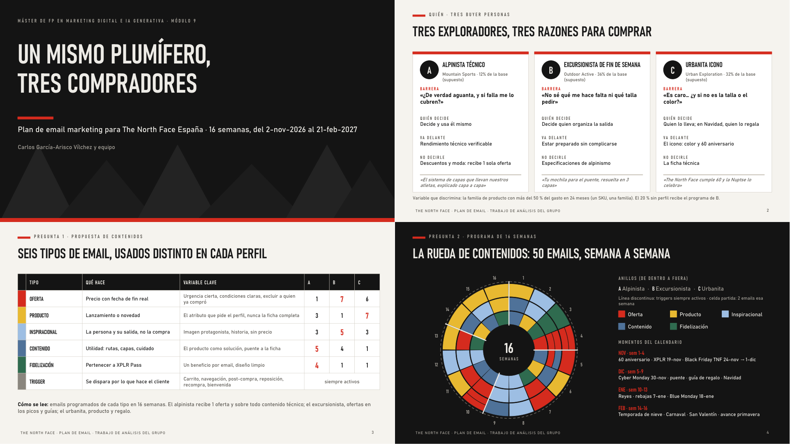

# plan-email-marca

Skill de Claude Code para montar, en cualquier marca, un **plan de comunicación solo por email por buyer persona**. Responde a las cuatro preguntas típicas de un brief:
1. propuesta de contenidos;
2. programa semana a semana;
3. impactos por persona;
4. total de piezas.

El criterio (personas, calendario, eventos con fuente) va en un archivo `marca.json`. Un comando lo convierte en una entrega que se puede enseñar:

| Sale | Para qué |
|---|---|
| Excel con fórmulas vivas (8 hojas) | Responde a las 4 preguntas; cambias un supuesto y se recalcula todo |
| Deck de 7 diapositivas (.pptx y .pdf) | Personas, tipos de email, rueda de contenidos, momentos clave, números y medición |
| Vistas previas (.png) | Para revisarlo y enseñarlo sin abrir PowerPoint |
| Defensa (.pdf) | Ejemplo trabajado y preguntas trampa para defender el Excel |
| Guion (.pdf) | Lo que dice cada ponente, en formato storytelling |



## Caso de origen: The North Face

Trabajo de clase del Máster de FP en Marketing Digital e IA Generativa (Módulo 9, noviembre de 2026), hecho en grupo y presentado el 17-nov-2026. El plan cubre 16 semanas, del 2-nov-2026 al 21-feb-2027, con Black Friday, Navidad, Reyes y rebajas, y 3 perfiles:
- alpinista técnico;
- excursionista de fin de semana;
- urbanita icono.

Resultado: 50 emails, 1.661.240 impactos y 67 piezas.

- Las personas siguen la segmentación pública de VF Corp: Mountain Sports, Outdoor Active y Urban Exploration.
- Las fechas de la promoción, el programa XPLR Pass, la garantía y las devoluciones se verificaron en la web de la marca el 17-nov-2026.
- **La base de suscriptores y el reparto entre perfiles son supuestos**, porque no tenemos el CRM de la marca. Están marcados como tales y se sustituyen con `importar.py`.
- Es un análisis académico con datos públicos. El deck que genera esta plantilla (el de arriba) no usa el logo de la marca; la entrega final de clase, con diseño visual de un compañero de equipo sobre esta base, sí lo lleva, y puede verse en el [caso del portfolio](https://carlosarisco55-max.github.io/casos/plan-email-north-face/).

Entrega completa: [deck en PDF](ejemplos/muestras/north-face/TNF-plan-email.pdf) · [Excel](ejemplos/muestras/north-face/plan_email_TNF.xlsx) · [defensa](ejemplos/muestras/north-face/defensa_TNF.pdf) · [guion](ejemplos/muestras/north-face/guion_TNF.pdf).

Además hay dos marcas ficticias que prueban que la plantilla se adapta:

| Marca | Perfiles | Semanas | Entrega |
|---|---|---|---|
| Lumen Café | 2 | 12 | [deck](ejemplos/muestras/lumen-cafe/LUMEN-plan-email.pdf) · [Excel](ejemplos/muestras/lumen-cafe/plan_email_LUMEN.xlsx) |
| Rodalia Bikes | 4 | 10 | [deck](ejemplos/muestras/rodalia-bikes/RODALIA-plan-email.pdf) · [Excel](ejemplos/muestras/rodalia-bikes/plan_email_RODALIA.xlsx) |

Rodalia la montó un agente que solo había leído la skill, como prueba de que se entiende sin contexto previo.

## Usarlo

Requisitos: Python 3.10+ con `openpyxl` y `pymupdf`, Node 18+, LibreOffice y, en Windows, Microsoft Edge para los PDF.

```
pip install openpyxl pymupdf defusedxml   # defusedxml: openpyxl lo usa para leer con seguridad Excel de terceros
cd motor && npm ci --ignore-scripts && cd ..
python motor/entrega.py ejemplos/lumen-cafe.json --abrir
```

**Con datos reales de la marca.** `importar.py` lee un Excel o CSV y sustituye los supuestos de la base y del reparto (y, si quieres, de las tasas de los triggers). Admite dos formas de tabla:
- **A:** una fila por cliente, con su segmento ya asignado.
- **B:** una fila por línea de compra. Se asigna el perfil por la familia de producto con más del 50 % del gasto.

El Excel enseña el dato real junto a lo que suponíamos: la diferencia es lo que el dato corrige de la hipótesis.

```
python motor/importar.py marca.json clientes.xlsx --hoja Clientes --perfil Segmento --suscrito Optin
python motor/importar.py marca.json ventas.csv --cliente ID --familia Familia --importe Importe --fecha Fecha
```

## Cómo se sabe que funciona

`python motor/test_motor.py` comprueba cuatro cosas:
1. **El caso real se reproduce.** The North Face da exactamente las cifras que se presentaron.
2. **El Excel y el cálculo en Python coinciden.** Para cada ejemplo, y también con datos importados, el Excel recalculado por LibreOffice da lo mismo que el cálculo en Python, celda a celda.
3. **La validación bloquea los errores que se corrigieron a mano en el caso real:**
   - un perfil «sin descuentos» que recibe ofertas;
   - más emails de los permitidos por semana;
   - un reparto que no suma 100 %;
   - triggers metidos en el calendario.

   Además avisa de los titulares que nunca se envían.
4. **El importador cuenta bien** las dos formas de tabla: filtro de opt-in, ventana de 24 meses, importes con coma decimal y familias sin perfil.

## Estructura

| Ruta | Qué es |
|---|---|
| `SKILL.md` | El proceso en 8 fases y qué skill se usa en cada una |
| `references/` | Formato de `marca.json` y checklist de auditoría (errores reales del caso) |
| `motor/entrega.py` | Todo de una vez: valida, Excel, deck, PDF, vistas previas, defensa y guion |
| `motor/generar.py` | `marca.json` → Excel + `cifras.json` + defensa |
| `motor/importar.py` | Datos reales de la marca → `marca.json` |
| `motor/deck.js` | Deck .pptx (pptxgenjs 3.12.0), de 1 a 4 perfiles y cualquier número de semanas |
| `motor/render.py` · `motor/md_pdf.py` | Vistas previas · Markdown a PDF con los colores de la marca |
| `ejemplos/` | Los tres `marca.json`, el guion de The North Face y las entregas generadas en `muestras/` |

## Límites

- Solo email. Para SMS, redes o paid hay que ampliar el motor.
- La investigación, las personas y los asuntos son trabajo de criterio: el motor los valida y los cuenta, pero no los escribe.

Licencia MIT.
